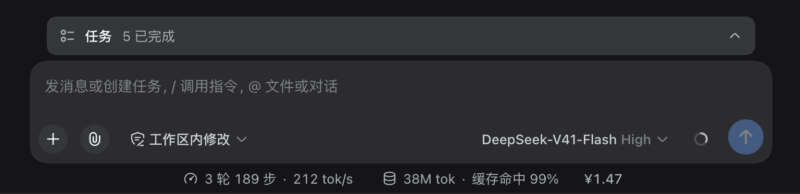

# dsh-billing-mini-tag

[](LICENSE)
[](https://github.com/topics/dsh-plugin)

English | [中文](README.zh.md)

Show the **current session's spend** (`¥x.xx`) in the composer statistics row,
immediately to the right of the cache-hit pill. Amounts are priced from the
[official DeepSeek token quote](https://api-docs.deepseek.com/zh-cn/quick_start/pricing/).

<p align="center">
  
  <br>
  <sub><em>the ¥1.47 on the right is this plugin</em></sub>
</p>

## Install

```sh
dsh plugin --profile web add github:Refone/dsh-billing-mini-tag
```

Restart `dsh web` and refresh the Web GUI, then send a message. To pin a
release instead of tracking `main`:

```sh
dsh plugin --profile web add https://github.com/Refone/dsh-billing-mini-tag/archive/refs/tags/v0.2.0.tar.gz
```

Update by running the same `add` command again. Remove with:

```sh
dsh plugin --profile web remove dsh-billing-mini-tag
```

> Installing from GitHub requires the host to read the repository. If your
> network cannot reach GitHub, install the npm-style tarball from the
> [releases page](https://github.com/Refone/dsh-billing-mini-tag/releases) once
> one is published.

## What it shows

- **Session spend only.** The tag totals the token usage recorded in the
  current session's durable log. It is not an account balance and not a
  cross-session total.
- **Live while you work.** The browser half polls the host route once a second,
  so the number moves as steps complete without a page reload.
- **Immediately right of the cache-hit pill.** The tag portals itself into the
  official statistics row instead of adding a second dock line, and it stays
  last even while the official pills mount and unmount.

## How it works

The package ships two halves:

| Half | Entry | Responsibility |
| --- | --- | --- |
| Host | `src/index.js` (`.` export) | Serves `GET /plugin-billing-mini-tag/cost?session=<id>`, folds the session log per assistant step, and refreshes the official quote. |
| Browser | `src/client.js` (`./client` export) | Registers a dock entry and portals the `¥…` tag into `[data-composer-stats]`. |

The host half:

1. Fetches the official Chinese pricing page at startup and again on every
   message send, caching the last good quote. The request has an 8s timeout and
   a built-in quote is used until the first successful fetch (and when the page
   is unreachable).
2. Folds `assistant/attempt` / `assistant/message` usage events per
   `turn:step`; a repeated step replaces its predecessor, and an
   `llm/retry-started` makes the retried attempt bill as a separate call. This
   mirrors DSH's own `tokenUsage` projection.
3. Remembers which model actually served each step, so a mid-session model
   switch is priced at the right rate.
4. Returns a rounded display string (`¥0.00`) plus raw tokens, per-model
   breakdown, quote source, and unknown-model names for debugging. Unknown
   sessions, unloaded logs, and failed quote fetches degrade to zero or the
   previous quote instead of throwing.

The route is same-origin only: it rejects cross-site callers and accepts
header-less probes only from loopback. A companion debug route,
`GET /plugin-billing-mini-tag/quote`, returns the cached quote and current
prices. Nothing is sent anywhere except the pricing-page request itself; there
is no telemetry.

## Pricing

Prices are CNY per 1M tokens from the official page:

| Bucket | How it is charged |
| --- | --- |
| Cache hit (input read from cache) | cache-hit price |
| Cache miss (uncached input) | cache-miss price |
| Cache write | cache-miss price |
| Output | output price |

Peak windows are evaluated in Beijing time (no DST): **Mon–Fri 09:00–12:00 and
14:00–18:00**. Chinese public holidays are not modelled, so weekday windows are
the best local approximation of the official peak definition. Models the quote
cannot classify fall back to the `deepseek-flash` bucket, and the route's debug
payload names them (`unknownModels`).

## Requirements

- A DSH **web** profile. The package declares `dsh.engines.dsh` as
  `>=0.1.5-rc.3`, the version it is developed and tested against.
- Node.js **20 or newer**.
- React 18 is provided by the host (declared as a peer dependency); the plugin
  has no runtime dependencies of its own.
- Network access to `api-docs.deepseek.com` for live quotes. Offline installs
  still work with the embedded quote.

## Development

There is **no build step**: both halves are plain ESM/JS, and the browser half
is a hand-written module-loader wrapper that needs no bundler. `pnpm pack`
ships `src/`, `cordis.patch.yml`, the READMEs, the changelog, the license, and
the screenshot.

```sh
node scripts/check-release.mjs   # publishing requirements + module smoke test
pnpm pack --dry-run              # inspect the exact tarball contents
```

`scripts/check-release.mjs` verifies the four things the DSH ecosystem scans
for: the `dsh-plugin` keyword, a copyable `dsh plugin --profile web add …`
command in the README, an exported `apply(ctx)` module, and a resolvable
`dsh.bundle.patch` bundle declaration.

```text
.
├── src/index.js          # host half (apply, quote, session fold, HTTP route)
├── src/client.js         # browser half (dock entry + ¥ tag)
├── cordis.patch.yml      # bundle patch: inserts the plugin into a profile
├── scripts/check-release.mjs
├── docs/development-trace.md
└── showcase.png
```

## License

[MIT](LICENSE) © 2026 Refone
