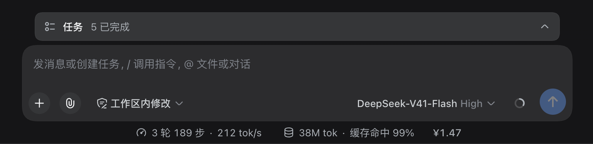

# dsh-billing-mini-tag

[](LICENSE)
[](https://github.com/topics/dsh-plugin)

English | [中文](README.zh.md)

Show the **current session's spend** (`¥x.xx`) at the right end of the composer
statistics row — to the right of the context-usage meter. Amounts are priced
from the [official DeepSeek token quote](https://api-docs.deepseek.com/zh-cn/quick_start/pricing/).

<p align="center">
  
  <br>
  <sub><em>the ¥1.47 on the right is this plugin</em></sub>
</p>

## Install

```sh
dsh plugin --profile web add github:Refone/dsh-billing-mini-tag
```

Restart `dsh web` and refresh the Web GUI, then send a message. To pin a
release instead of tracking `main`:

```sh
dsh plugin --profile web add https://github.com/Refone/dsh-billing-mini-tag/archive/refs/tags/v0.1.0.tar.gz
```

Update by running the same `add` command again. Remove with:

```sh
dsh plugin --profile web remove dsh-billing-mini-tag
```

The package ships plain JavaScript with no `prepare` script, so a GitHub
install needs neither a build step nor pnpm's build-script authorization.

> Installing from GitHub requires the host to read the repository. If your
> network cannot reach GitHub, install the npm-style tarball from the
> [releases page](https://github.com/Refone/dsh-billing-mini-tag/releases) once
> one is published.

## What it shows

- **Session spend only.** The tag totals the token usage recorded in the
  current session's durable log. It is not an account balance and not a
  cross-session total.
- **Live while you work.** The browser half polls the host route once a second,
  so the number moves as steps complete without a page reload.
- **At the right end of the row.** The tag is a `conversation.composer.dock`
  entry with `order: 2`. That slot renders before the shipped context-usage
  meter, so the pill also carries a positive CSS `order` to stay to the meter's
  right — the original layout — without starting a second line.

## How it works

The package ships two halves:

| Half | Entry | Responsibility |
| --- | --- | --- |
| Host | `src/index.js` (`.` export) | Serves `GET /plugin-billing-mini-tag/cost?session=<id>`, folds the session log per assistant step, and refreshes the official quote. |
| Browser | `src/client.js` (`./client` export) | Registers the `billing-mini-tag` composer-dock entry and keeps the `¥…` pill at the right end of the statistics row, right of the context-usage meter. |

The plugin declares no `meta.title`. DSH falls back to the package name
(`dsh-billing-mini-tag`), which is also the component row's id and module name,
so the component row no longer prints the name twice more under its own title.
`locale/*.json` keeps the description — which DSH does not derive from the
package — plus the pill tooltip copy.

The host half:

1. Fetches the official Chinese pricing page at startup and again on every
   message send, caching the last good quote. The request has an 8s timeout and
   a built-in quote is used until the first successful fetch (and when the page
   is unreachable).
2. Folds `assistant/attempt` / `assistant/message` usage events per
   `turn:step`; a repeated step replaces its predecessor, and an
   `llm/retry-started` makes the retried attempt bill as a separate call. This
   mirrors DSH's own `tokenUsage` projection.
3. Remembers which model actually served each step, so a mid-session model
   switch is priced at the right rate.
4. Returns a rounded display string (`¥0.00`) plus raw tokens, per-model
   breakdown, quote source, and unknown-model names for debugging. Unknown
   sessions, unloaded logs, and failed quote fetches degrade to zero or the
   previous quote instead of throwing.

The route is same-origin only: it rejects cross-site callers and accepts
header-less probes only from loopback. A companion debug route,
`GET /plugin-billing-mini-tag/quote`, returns the cached quote and current
prices. Nothing is sent anywhere except the pricing-page request itself; there
is no telemetry.

## Pricing

Prices are CNY per 1M tokens from the official page:

| Bucket | How it is charged |
| --- | --- |
| Cache hit (input read from cache) | cache-hit price |
| Cache miss (uncached input) | cache-miss price |
| Cache write | cache-miss price |
| Output | output price |

Peak windows are evaluated in Beijing time (no DST): **Mon–Fri 09:00–12:00 and
14:00–18:00**. Chinese public holidays are not modelled, so weekday windows are
the best local approximation of the official peak definition. Models the quote
cannot classify fall back to the `deepseek-flash` bucket, and the route's debug
payload names them (`unknownModels`).

## Requirements

- DSH **0.2.x** — the package declares `engines.dsh` as `>=0.2.0`, the range
  with the composer-dock list slot this control registers into.
- Node.js **20 or newer**.
- React 18 is provided by the host (declared as a peer dependency); the plugin
  has no runtime dependencies of its own.
- Network access to `api-docs.deepseek.com` for live quotes. Offline installs
  still work with the embedded quote.
- The browser half injects DSH's client `locale` service (shipped with the web
  and desktop apps) for its pill tooltip. The fiber waits for it, so the
  tooltip never renders as a raw key.

> **Needs the `webServer` service.** The plugin serves its cost route through
> the shipped `web` bundle, so any profile that mounts it works — the `web`
> profile and the Desktop app's `desktop` profile both do. Installing it into a
> custom profile that only has `dsh-base` leaves the entry waiting for
> `webServer`, and DSH refuses to boot. Initialize custom profiles from the web
> template (`dsh --profile <name> --from-default-profile web`).

## Development

There is **no build step**: both halves are plain ESM/JS, and the browser half
is a hand-written module-loader wrapper that needs no bundler. `pnpm pack`
ships `src/`, `cordis.patch.yml`, the READMEs, the changelog, the license, and
the screenshot.

```sh
node scripts/check-release.mjs   # publishing requirements
node scripts/test-client.mjs     # browser-half smoke test (also `pnpm test`)
pnpm pack --dry-run              # inspect the exact tarball contents
```

`scripts/check-release.mjs` verifies what the DSH ecosystem scans for — the
`dsh-plugin` keyword, a copyable `dsh plugin --profile web add …` command in
the README, an exported `apply(ctx)` module, a resolvable `dsh.bundle.patch`
bundle declaration — plus the package metadata, icon and locale keys.

`scripts/test-client.mjs` stubs `window.__ModuleLoader__`, React, the Cordis
slots service and the locale runtime, then renders what the GUI would get: the
`¥x.xx` pill and its tooltip in both shipped languages. The fake `ctx.get()`
answers nothing, so a regression back to an optional locale lookup fails the
test instead of shipping raw keys.

```text
.
├── src/index.js          # host half (apply, quote, session fold, HTTP route)
├── src/client.js         # browser half (composer-dock control + ¥ pill)
├── locale/{en,zh}.json   # plugin description + pill tooltip copy
├── icon.svg              # inventory artwork
├── cordis.patch.yml      # bundle patch: inserts the plugin into a profile
├── scripts/check-release.mjs
├── scripts/test-client.mjs
├── docs/development-trace.md
└── showcase.png
```

## License

[MIT](LICENSE) © 2026 Refone
