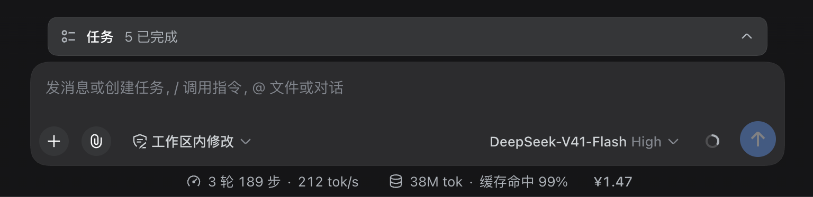

# dsh-billing-mini-tag

[](LICENSE)
[](https://github.com/topics/dsh-plugin)

[English](README.md) | 中文

在当前会话输入框下方的统计行最右侧、**上下文用量（context usage）**右边，常驻显示
本会话消费金额（`¥x.xx`）。金额按 [DeepSeek 官方 Token 报价](https://api-docs.deepseek.com/zh-cn/quick_start/pricing/)
计算。

<p align="center">
  
  <br>
  <sub><em>右侧的 ¥1.47 就是这个插件</em></sub>
</p>

## 安装

两种安装途径，按你的 DSH 运行环境来选。

### 1. 在 shell 里安装

下面四种是**并列的命令行安装方式**：任选其一即可，不要四条都执行。
四种方式最后都使用同一条 `dsh plugin --profile web add` 命令，区别只在安装源。

**方式 A — npm 包（推荐，跟随最新发布版）：**

```sh
dsh plugin --profile web add dsh-billing-mini-tag
```

**方式 B — 固定版本的 Release 源码包（版本可复现）：**

```sh
dsh plugin --profile web add https://github.com/Refone/dsh-billing-mini-tag/archive/refs/tags/v0.3.1.tar.gz
```

**方式 C — 仓库 main 分支（跟随最新开发代码）：**

```sh
dsh plugin --profile web add github:Refone/dsh-billing-mini-tag
```

**方式 D — 克隆到本地（用于开发调试）：**

```sh
git clone https://github.com/Refone/dsh-billing-mini-tag.git
cd dsh-billing-mini-tag
dsh plugin --profile web add "$PWD"
```

`dsh plugin add` 是在 profile 目录里转发给 pnpm 的，所以要传绝对路径；
`cd` 之后的 `"$PWD"` 正好是绝对路径。不要写成 `add .`，那会指向 profile 目录，
而不是这个克隆目录。以后在克隆目录里 `git pull` 即可更新代码。

安装完成后重启 `dsh web` 并刷新页面，然后发送一条消息。
再次执行同一条 `add` 命令（保持同一个安装源）即可更新；卸载：

```sh
dsh plugin --profile web remove dsh-billing-mini-tag
```

包内是纯 JavaScript、没有 `prepare` 脚本，因此从 GitHub 安装既不需要构建，也不需要
pnpm 的构建脚本授权。

### 2. 在 DeepSeek Harness Desktop 里安装

1. 侧栏打开 **插件**。
2. 点 **添加插件** → **安装第三方插件**。
3. 在 **包名或地址** 里填入 `dsh-billing-mini-tag`（或
   `github:Refone/dsh-billing-mini-tag`），点 **安装**。
4. 提示时点 **立即启用**；如果 DSH 提示需要重启，就重启应用——宿主半边要挂载计费路由，
   第一次安装需要重启。
5. 发送一条消息：`¥` 金额出现在输入框统计行最右侧、上下文用量右边。

如果访问不到 npm 或 GitHub，在同一个对话框里展开 **安装源** 换成镜像，或直接粘贴
[Releases](https://github.com/Refone/dsh-billing-mini-tag/releases) 里的 tarball 地址。

## 显示什么

- **只统计当前会话。** 金额来自该会话持久化日志中的 token 用量，不是账号余额，
  也不是所有会话的累计。
- **边用边更新。** 浏览器半边每秒轮询一次宿主路由，步骤完成后数字就会变化，
  不需要刷新页面。
- **在统计行最右侧。** 角标是 `conversation.composer.dock` 里 `order: 2` 的统计项。
  该槽位渲染在官方的上下文用量指示之前，因此角标再带一个正的 CSS `order`，保持排在
  它右边（最初的布局），不会另起一行。

## 工作原理

包内包含两个半边：

| 半边 | 入口 | 职责 |
| --- | --- | --- |
| 宿主 | `src/index.js`（`.` 导出） | 提供 `GET /plugin-billing-mini-tag/cost?session=<id>`，按 assistant step 折叠会话日志，并刷新官方报价。 |
| 浏览器 | `src/client.js`（`./client` 导出） | 注册 `billing-mini-tag` 这个 composer dock 统计项，把 `¥…` 角标保持在统计行最右侧、上下文用量右边。 |

插件不声明 `meta.title`：DSH 会回退到包名 `dsh-billing-mini-tag`，而它同时也是组件行的
id 与模块名，因此组件行不再在标题下重复两行技术名。`locale/*.json`
保留描述（DSH 不会从包里推导它），以及角标 tooltip 的文案。

宿主半边：

1. 启动时抓取一次官方中文报价页，之后每次发送消息再抓一次，并缓存最近一次
   成功结果。请求 8 秒超时；首次抓取成功前（以及页面不可达时）使用内置报价。
2. 按 `turn:step` 折叠 `assistant/attempt` / `assistant/message` 的 usage：同一步
   重复上报时后者替换前者，`llm/retry-started` 会让重试单独计费，与 DSH 自身的
   `tokenUsage` 投影保持一致。
3. 记住每一步实际服务的模型，因此会话中途切换模型也按对应单价计费。
4. 返回两位小数的展示字符串（`¥0.00`），并附带原始 token 数、分模型明细、
   报价来源与未知模型名，便于排查。未知会话、日志未加载、报价抓取失败都会
   退化为 0 或沿用上一份报价，不会抛错打扰输入框。

该路由只接受同源请求：拒绝跨站调用，无请求头的探测只接受 loopback。另有调试
路由 `GET /plugin-billing-mini-tag/quote` 返回缓存的报价与当前单价。除抓取
报价页外不向任何地方发送数据，也没有遥测。

## 计费口径

单价为官方页面的「元 / 百万 token」：

| 桶 | 计价方式 |
| --- | --- |
| 缓存命中（从缓存读取的输入） | 缓存命中价 |
| 缓存未命中（未缓存输入） | 缓存未命中价 |
| 缓存写入 | 缓存未命中价 |
| 输出 | 输出价 |

高峰时段按北京时间判断（无夏令时）：**周一至周五 09:00–12:00、14:00–18:00**。
官方报价未包含中国法定节假日，因此用工作日窗口做本地近似。报价无法识别的
模型按 `deepseek-flash` 计价，路由的调试字段会在 `unknownModels` 中列出它们。

## 环境要求

- DSH **0.2.x**：包内声明 `engines.dsh` 为 `>=0.2.0`，该版本区间才有本插件
  使用的 composer dock 列表槽位。
- Node.js **20 及以上**。
- React 18 由宿主提供（peer dependency）；插件本身没有运行时依赖。
- 可访问 `api-docs.deepseek.com` 以获取实时报价；离线时仍可用内置报价。
- 浏览器半边注入 DSH 客户端的 `locale` 服务（web 与 desktop 应用自带），用于角标
  tooltip；fiber 会等待该服务，因此 tooltip 不会退化成原始 key。

> **需要 `webServer` 服务。** 插件通过随 `web` bundle 提供的 `webServer` 暴露
> 计费路由，因此只要 profile 挂载了 web bundle 即可：`web` profile 和桌面应用
> 的 `desktop` profile 都满足。装进只含 `dsh-base` 的自定义 profile 时，该行会
> 一直等待 `webServer`，DSH 会拒绝启动。请用 web 模板初始化自定义 profile
> （`dsh --profile <name> --from-default-profile web`）。

## 开发

**没有构建步骤**：两个半边都是普通 ESM/JS，浏览器半边是手写的模块加载器
包装，不需要打包器。`pnpm pack` 会打包 `src/`、`cordis.patch.yml`、两份
README、CHANGELOG、LICENSE 和截图。

```sh
node scripts/check-release.mjs   # 发布要求检查
node scripts/test-client.mjs     # 浏览器半边冒烟测试（也可 pnpm test）
pnpm pack --dry-run              # 查看最终 tarball 内容
```

`scripts/check-release.mjs` 检查 DSH 生态扫描的内容：`dsh-plugin` 关键字、README
中可复制的 `dsh plugin --profile web add …` 命令、导出的 `apply(ctx)` 模块、
可解析的 `dsh.bundle.patch` bundle 声明，以及包元信息、图标和 locale 键。

`scripts/test-client.mjs` 用桩替换 `window.__ModuleLoader__`、React、Cordis slots
服务和 locale 运行时，渲染页面真正会拿到的东西：`¥x.xx` 角标，以及中英两种语言的
tooltip。假上下文的 `ctx.get()` 恒为空，所以一旦有人改回可选查询，测试会失败，而不是
把原始 key 发到用户眼前。

```text
.
├── src/index.js          # 宿主半边（apply、报价、会话折叠、HTTP 路由）
├── src/client.js         # 浏览器半边（composer dock 统计项 + ¥ 角标）
├── locale/{en,zh}.json   # 插件描述 + 角标 tooltip 文案
├── icon.svg              # 插件列表图标
├── cordis.patch.yml      # bundle patch：把插件插入 profile
├── scripts/check-release.mjs
├── scripts/test-client.mjs
├── docs/development-trace.md
└── showcase.png
```

## 许可证

[MIT](LICENSE) © 2026 Refone
