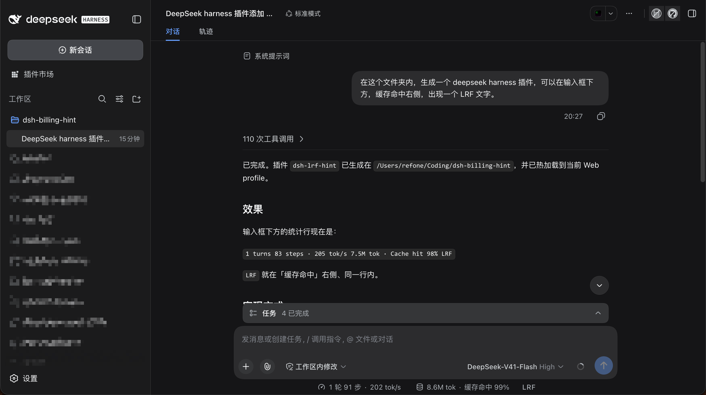
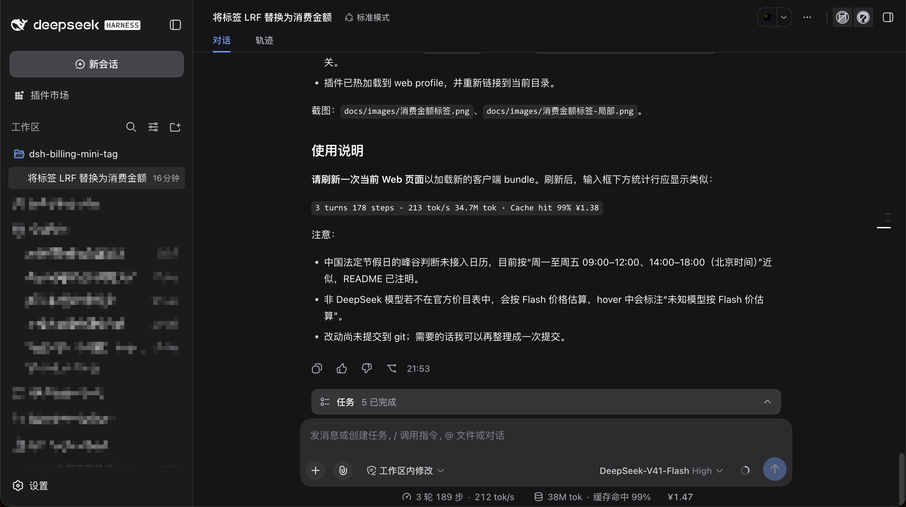

# 开发日志

1. 在这个文件夹内，生成一个 deepseek harness 插件，可以在输入框下方，缓存命中右侧，出现一个 LRF 文字。

commit: `95d474c9359d2e7ec13de40408c8171f2a3fd0a7`

2. 将 tag 中的文字 "LRF" 替换为 "¥0.00"，其中数值代表当前会话实际消费金额：按官方 Token 报价、模型选择与 Token 使用量计算，每次点击发送消息时拉取一次最新官方报价，金额保留两位小数。
   - 官方报价来源：<https://api-docs.deepseek.com/zh-cn/quick_start/pricing/>（中文页面直接给出人民币价格与高峰/空闲时段）。
   - 宿主半边按会话日志逐 step 折叠 usage 与模型，浏览器半边轮询 `/plugin-billing-mini-tag/cost` 并渲染 `¥x.xx`。

3. 适配 DSH 0.2：官方统计行不再有 `[data-composer-stats]` 容器，原来的 portal 无处可挂。改为注册
   `conversation.composer.dock` 里的 `billing-mini-tag` 统计项（`order: 2`），与官方 `activity`、
   `usage` 同处一行，排在缓存命中右侧；样式复用同款排版 token 与内边距，并带
   `data-composer-stat` 标记。同时按 0.2 的 stream 记录结构（`record.chunk.usage`）读取 usage，
   补上 locale 文案、图标与 `>=0.2.0` 的版本约束。
