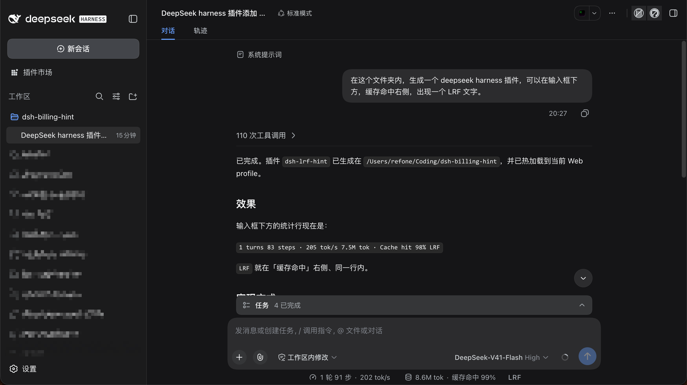
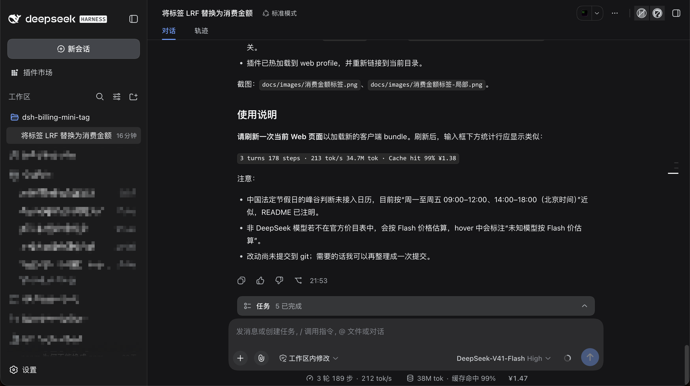

# 开发日志

1. 在这个文件夹内，生成一个 deepseek harness 插件，可以在输入框下方，缓存命中右侧，出现一个 LRF 文字。

commit: `95d474c9359d2e7ec13de40408c8171f2a3fd0a7`

2. 将 tag 中的文字 "LRF" 替换为 "¥0.00"，其中数值代表当前会话实际消费金额：按官方 Token 报价、模型选择与 Token 使用量计算，每次点击发送消息时拉取一次最新官方报价，金额保留两位小数。
   - 官方报价来源：<https://api-docs.deepseek.com/zh-cn/quick_start/pricing/>（中文页面直接给出人民币价格与高峰/空闲时段）。
   - 宿主半边按会话日志逐 step 折叠 usage 与模型，浏览器半边轮询 `/plugin-billing-mini-tag/cost` 并渲染 `¥x.xx`。

